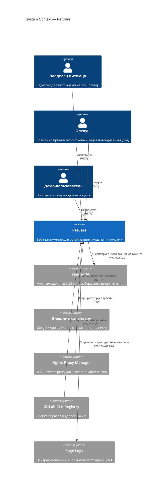
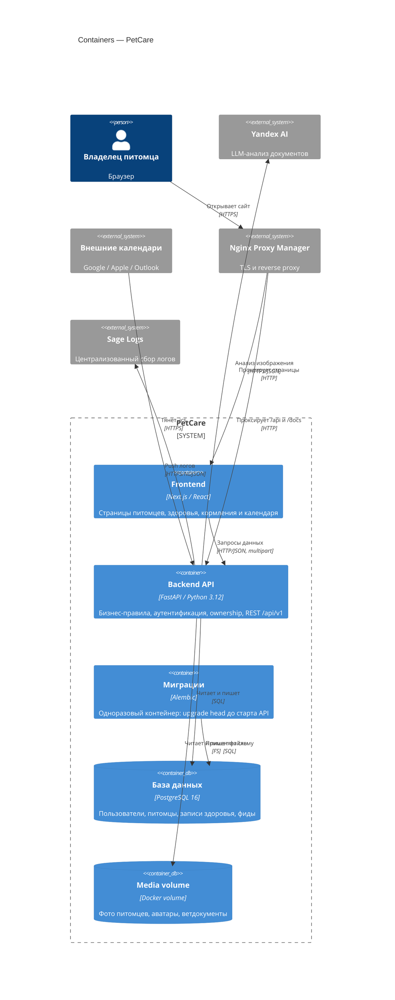
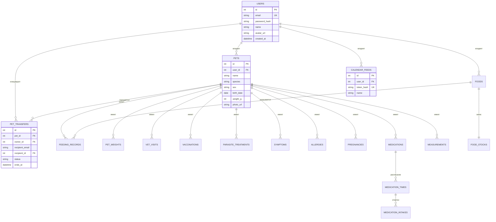
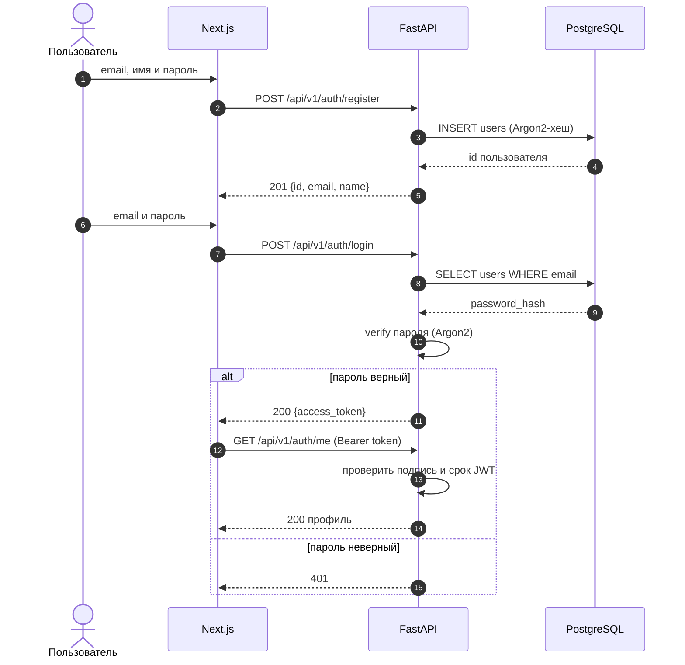
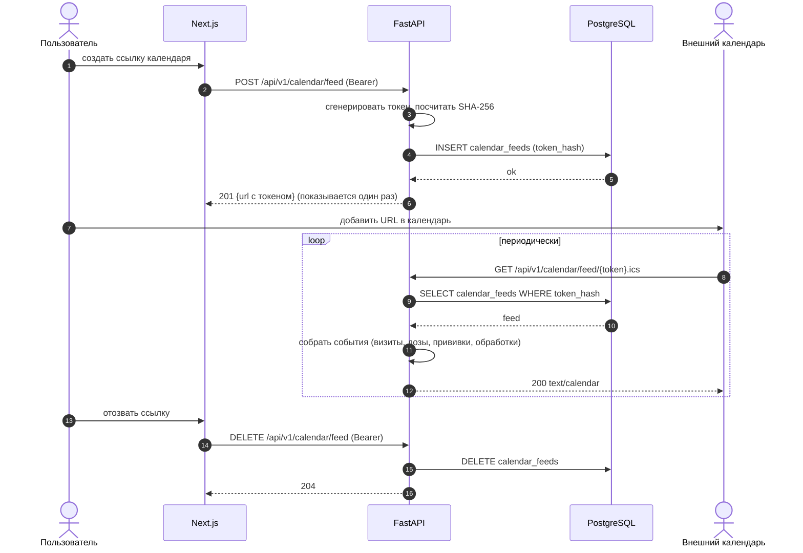

# RFC: PetCare — единая система организации ухода за домашними животными

- **Статус:** принятая спецификация, соответствующая текущей реализации
- **Версия:** 1.0
- **Дата:** 17 октября 2026 года
- **Тип документа:** продуктовый и технический RFC для хакатона
- **Область:** пользовательский интерфейс, REST API, база данных, хранение файлов, интеграции и эксплуатация
- **Репозиторий:** PetCare

> Этот документ фиксирует требования, архитектуру, пользовательские сценарии, контракты API, правила безопасности, модель данных, эксплуатационные решения и критерии проверки системы. Реализация в репозитории должна рассматриваться совместно с этим RFC: документ описывает не абстрактный прототип, а фактически разработанную систему.

---

## 1. Аннотация

PetCare — цифровой органайзер для владельцев домашних животных. Система объединяет в одном месте:

1. профили питомцев;
2. историю кормления и каталог кормов;
3. запасы кормов и контроль расхода;
4. медицинские записи;
5. назначения и фактический приём лекарств;
6. прививки, симптомы, аллергии и беременности;
7. визиты к ветеринару;
8. измеряемые показатели и историю веса;
9. календарь предстоящих событий;
10. экспорт и подписку на календарь в формате iCalendar;
11. распознавание фотографий ветеринарных документов с помощью LLM;
12. безопасную аутентификацию и разграничение доступа между владельцами.

Основная ценность продукта — не диагностика и не автоматическое назначение лечения, а структурированное хранение пользовательских данных и своевременная организация ухода. PetCare помогает владельцу помнить, что и когда произошло, что запланировано и какие сведения необходимо показать ветеринарному специалисту.

---

## 2. Контекст и проблема

Информация о питомце обычно распределена между бумажными справками, фотографиями документов, заметками в телефоне, переписками с клиникой и календарём. Это создаёт четыре системные проблемы:

- исторические сведения трудно быстро найти;
- повторные процедуры и лекарства легко пропустить;
- данные о разных питомцах смешиваются;
- фотографии документов не превращаются в структурированную историю.

PetCare решает проблему через единый аккаунт владельца. Владелец создаёт профили питомцев, добавляет записи и получает единый календарь. Каждая запись связана с конкретным пользователем и питомцем, поэтому данные изолированы на уровне API и базы данных.

### 2.1. Цели

Система должна:

- обеспечить регистрацию, вход и защищённые пользовательские сессии;
- дать владельцу CRUD-операции над профилями питомцев;
- хранить исторические записи кормления и здоровья;
- контролировать принадлежность каждой сущности владельцу;
- показывать предстоящие визиты, прививки и дозы лекарств;
- экспортировать календарь в совместимом формате `.ics`;
- принимать фотографии питомцев, аватары и ветеринарские документы;
- извлекать из ветеринарского документа строго определённый набор полей;
- предоставлять понятные ошибки валидации и статусы HTTP;
- быть пригодной для локального запуска, тестирования и развёртывания в Docker.

### 2.2. Не цели

В текущий объём не входят:

- постановка ветеринарных диагнозов;
- самостоятельное назначение лекарств или дозировок;
- медицинские рекомендации, не указанные пользователем или в документе;
- социальная сеть владельцев;
- интеграция с ветеринарными клиниками как медицинскими информационными системами;
- сложная ролевая модель, OAuth-провайдеры, Redis и отдельная инфраструктура токенов;
- автоматическое принятие решений о здоровье животного.

---

## 3. Термины и определения

| Термин | Определение |
|---|---|
| Владелец | Аутентифицированный пользователь, которому принадлежит питомец. |
| Опекун (caretaker) | Получатель принятой временной передачи: читает данные питомца и добавляет повседневные записи, но не может менять или удалять их. |
| Передача питомца | Запрос на передачу владения/ухода другому пользователю по email со сроком и статусной моделью. |
| Питомец | Животное, принадлежащее владельцу (или временно находящееся у опекуна) и описанное профилем. |
| Медицинская запись | Симптом, аллергия, беременность, прививка, лекарство, приём лекарства, визит, обработка от паразитов или измерение. |
| Событие | Элемент календаря, собранный из медицинских записей (визит, прививка, доза, обработка, день рождения). |
| Лента календаря | Секретная ссылка на персональный `.ics`-календарь без интерактивного входа. |
| Ветеринарный документ | Фотография отчёта или чека, анализируемая LLM. |
| Источник истины | Данные, сохранённые пользователем или явно извлечённые из документа; система не должна выдумывать сведения. |

---

## 4. Требования

### 4.1. Функциональные требования

#### RQ-001. Регистрация и аутентификация

Пользователь может:

- зарегистрироваться по email, имени и паролю;
- войти по email и паролю;
- получить JWT access token с ограниченным сроком действия;
- запросить собственный публичный профиль;
- изменить имя;
- изменить пароль только после проверки текущего пароля;
- загрузить и получить собственный аватар.

Email нормализуется, пароль не возвращается API и никогда не хранится в открытом виде.

#### RQ-002. Профиль питомца

Владелец может создать, просмотреть, изменить и удалить профиль питомца. Профиль включает:

- имя;
- вид;
- пол;
- породу;
- дату рождения;
- приблизительный возраст;
- текущий вес;
- фотографию.

Удаление питомца удаляет связанные пользовательские записи согласно правилам каскадного удаления.

#### RQ-003. Кормление

Для питомца можно вести историю кормлений. Запись поддерживает:

- корм из каталога или свободное название;
- количество в граммах;
- дату и время кормления;
- понравился ли корм питомцу;
- переносимость;
- реакцию и заметки.

История сохраняется как отдельные записи и не должна молча перезаписывать прошлые события.

#### RQ-004. Каталог кормов и запасы

Владелец может создавать собственный каталог кормов, указывать пищевые характеристики и управлять запасом в граммах. Система:

- не допускает отрицательные и некорректные количества;
- связывает кормление с кормом, если корм выбран из каталога;
- уменьшает доступный остаток при расходовании;
- возвращает конфликт, если запрошенное количество невозможно покрыть остатком;
- сохраняет историческую запись кормления даже при удалении каталожного корма.

#### RQ-005. Здоровье питомца

Для каждого питомца доступны отдельные разделы:

- симптомы;
- аллергии;
- беременность;
- вакцинации;
- лекарства;
- расписание и отметки приёма лекарств;
- визиты к ветеринару;
- обработки от паразитов (внутренние и наружные) с интервалом повторения и
  автоматическим расчётом даты следующей процедуры;
- измеряемые параметры и значения;
- история веса;
- агрегированный обзор и сводка.

Каждая запись имеет валидацию схемы, проверку существования сущности и проверку принадлежности питомца текущему владельцу или его временному опекуну (см. RQ-013).

#### RQ-006. Планирование лекарств

Для лекарства можно определить расписание. Система строит ожидаемые дозы на заданном диапазоне дат, показывает их в календаре и позволяет отметить фактический приём. Состояние дозы должно быть явно представлено как ожидаемое или выполненное; отмена и другие статусы не должны маскироваться под выполненный приём.

#### RQ-007. Календарь

Календарь объединяет:

- запланированные визиты;
- запланированные вакцинации;
- дозы лекарств;
- даты следующих обработок от паразитов;
- дни рождения питомцев (ежегодно, с указанием возраста).

Поддерживаются:

- диапазон дат;
- фильтрация по питомцу;
- фильтрация по типу события;
- список ближайших событий;
- локальная временная зона пользователя;
- экспорт в `.ics`;
- секретная подписочная ссылка.

Отменённые визиты и пропущенные дозы не попадают в обычный список событий. Вакцинации, обработки от паразитов и дни рождения являются событиями «на весь день», визиты и дозы могут иметь время.

#### RQ-008. Анализ ветеринарского документа

Владелец может отправить фотографию документа, относящегося к своему питомцу, и необязательный текстовый контекст. Разрешены PNG, JPEG и WebP. Сервер проверяет размер и фактический формат изображения до вызова LLM.

Из фотографии извлекаются ровно восемь полей:

1. имя животного;
2. дата визита;
3. причина визита;
4. стоимость именно ветеринарного приёма;
5. имя ветеринарного врача;
6. профессия или должность специалиста;
7. название или информация о клинике;
8. явно указанные рекомендации после визита.

Фотография имеет приоритет над пользовательским текстом. Текст может заполнить только поля, которые остались пустыми. LLM не должна ставить диагноз, назначать лечение или придумывать рекомендации.

#### RQ-009. Документация и проверяемость

API публикует OpenAPI-схему и Swagger UI. Контракты схем должны быть пригодны для ручной проверки и автоматических тестов.

#### RQ-010. Эксплуатация

Система должна запускаться локально и в Docker Compose, поддерживать миграции базы данных и проходить автоматические backend-тесты в CI/CD.

#### RQ-011. Передача питомца другому пользователю

Владелец может передать питомца другому человеку по email (аккаунт получателя
может быть создан позже). Передача имеет срок (`week`, `month`, `three_months`,
`indefinite`) и статусную модель:

- владелец создаёт приглашение (`pending`), адресованное `recipient_email`;
- получатель принимает (`accepted`) или отклоняет (`declined`);
- владелец может отозвать ещё не принятое приглашение (`cancelled`);
- получатель может запросить возврат (`return_requested`), владелец подтверждает
  возврат (`returned`) либо получатель отменяет запрос;
- по истечении срока временная передача помечается `expired`.

Инварианты:

- у питомца одновременно не более одной незавершённой передачи;
- до принятия питомец остаётся у текущего владельца;
- после принятия получатель становится владельцем и ведёт записи питомца;
- передать питомца самому себе нельзя (`422`).

#### RQ-012. Обработки от паразитов

Для питомца ведётся история обработок от внутренних и наружных паразитов. Каждая
запись содержит вид обработки, препарат, дату проведения и необязательный интервал
повторения. Система автоматически рассчитывает дату следующей процедуры
(`next_due_on`) как «дата обработки + интервал», при этом явно указанная дата
имеет приоритет, а сброс интервала очищает расчётную дату. Ближайшая обработка
попадает в обзор здоровья и в календарь.

#### RQ-013. Временная передача ухода (care access)

Пока питомец передан по принятой временной передаче (RQ-011), получатель получает
роль **опекуна** (`caretaker`) на срок передачи:

- опекун видит все данные питомца и может добавлять повседневные записи (кормление,
  симптомы, измерения, отметки приёма лекарств, визиты и обработки);
- опекун не может изменять или удалять записи, менять самого питомца и его
  медицинские настройки — попытка получает `403`, а не `404`;
- доступ действует ровно до окончания передачи (включая период ожидаемого возврата)
  и не зависит от действий прежнего владельца;
- посторонним питомец не виден (`404`), поэтому факт его существования не
  раскрывается.

Доступ опекуна используется при построении календаря и дашборда: питомец,
находящийся на передержке, появляется у опекуна наравне с собственными.

---

## 5. Архитектурное решение

### 5.1. Этапы проектирования

Документ покрывает все обязательные этапы проектирования; каждый этап раскрыт в
отдельном разделе и связан с кодом репозитория:

| Этап (system design) | Артефакт в документе |
|---|---|
| 1. Сбор и анализ требований | §2 Контекст, §4 Функциональные требования (use cases), §13 НФТ и §13.1 целевые показатели (RPS, SLA, объём данных, availability) |
| 2. Определение границ системы | §5.2.1 System Context (C4) |
| 3. Компоненты и потоки данных | §5.2.2 Containers (C4), §5.5 Механизмы масштабирования, sequence-диаграммы в §9.1 и §9.4 |
| 4. Проектирование API и модели данных | §6 API-контракт, §7 Модель данных и §7.9 ER-диаграмма, публикуемая OpenAPI-схема и Swagger UI |
| 5. Выбор технологий | §5.3 Технологический стек, §16 Архитектурные решения и альтернативы |

Дополнительно документ фиксирует эксплуатацию и качество: §11 Конфигурация,
§12 Развёртывание и CI/CD, §14 Стратегия тестирования. Сводное обоснование
соответствия решения требованиям приведено в §21.

### 5.2. Общая схема

#### 5.2.1. System Context (C4)

Границы системы и её окружение. Внутри границы — только PetCare; всё остальное —
акторы и внешние системы, с которыми PetCare обменивается данными.



#### 5.2.2. Containers (C4)

Логические контейнеры, из которых состоит PetCare, и потоки данных между ними.
Все контейнеры запускаются из одного [`docker-compose.yml`](docker-compose.yml:1)
на одной виртуальной машине.



Упрощённо потоки данных выглядят так:

```text
Браузер -> Next.js -> FastAPI -> PostgreSQL + media
                          |
                          +-> Yandex AI (анализ документов)
```

Backend является источником бизнес-правил и контроля доступа. Frontend не считается доверенной стороной и не может самостоятельно определять владельца данных.

Главное приложение и маршрутизация определены в [`backend/app/main.py`](backend/app/main.py:27). API версионируется префиксом `/api/v1`.

### 5.3. Технологический стек

| Слой | Решение | Обоснование |
|---|---|---|
| API | FastAPI | Типизированные схемы, OpenAPI, удобная обработка multipart и зависимостей. |
| Схемы | Pydantic | Единая валидация входных данных и ответов. |
| ORM | SQLAlchemy 2.x | Явная модель данных, синхронные и асинхронные сессии. |
| Миграции | Alembic | Версионируемое изменение схемы базы. |
| База | PostgreSQL | Надёжное production-хранилище и транзакционность. |
| Локальные тесты | SQLite | Быстрые изолированные тесты без обязательного внешнего сервера. |
| Аутентификация | JWT HS256 | Минимальная stateless-модель для hackathon MVP. |
| Пароли | Argon2 через `pwdlib` | Современное хеширование без хранения исходного пароля. |
| Файлы | Локальный volume | Простое и предсказуемое хранение в рамках хакатона. |
| LLM | Yandex AI через OpenAI-compatible client | Использование мультимодальной модели при сохранении строгого JSON-контракта. |
| Frontend | Next.js | Клиентская оболочка для страниц питомцев, здоровья, еды и календаря. |

### 5.4. Организация backend

Код разделён по ответственности:

- [`backend/app/api`](backend/app/api) — зависимости и HTTP-маршруты;
- [`backend/app/api/v1`](backend/app/api/v1) — версии API и предметные роутеры;
- [`backend/app/core`](backend/app/core) — конфигурация и безопасность;
- [`backend/app/db`](backend/app/db) — база и сессии;
- [`backend/app/models`](backend/app/models) — SQLAlchemy-модели;
- [`backend/app/schemas`](backend/app/schemas) — Pydantic-контракты;
- [`backend/app/services`](backend/app/services) — бизнес-логика;
- [`backend/app/integrations`](backend/app/integrations) — внешние сервисы, включая LLM;
- [`backend/tests`](backend/tests) — автоматические тесты.

Это разделение выбрано для того, чтобы HTTP-слой не содержал всю бизнес-логику, а интеграции можно было тестировать отдельно.

### 5.5. Механизмы масштабирования

Текущий контур рассчитан на показатели из §13.1. Ниже — что уже заложено под рост
и что вынесено в дорожную карту (§19).

Уже заложено:

- **Stateless API.** Backend не хранит состояние сессии: аутентификация построена
  на JWT, поэтому инстанс `api` можно масштабировать горизонтально за Nginx Proxy
  Manager без sticky-сессий.
- **Индексы и фильтры.** Все выборки ограничены владельцем и питомцем, по внешним
  ключам стоят индексы; календарь ограничен диапазоном 400 дней — это удерживает
  latency при пиковом RPS.
- **Разделение чтения и записи.** Тяжёлые внешние вызовы (LLM) изолированы и
  ограничены таймаутом и повторной попыткой, чтобы не блокировать обычные запросы.
- **Артефакты в registry.** Образы неизменяемы и тегированы SHA, поэтому откат и
  запуск нескольких инстансов сводятся к запуску того же тега.

Дорожная карта до целевого продукта:

- read-replica PostgreSQL и пул соединений (PgBouncer) для роста чтения;
- вынос медиа в объектное хранилище с приватными подписанными URL вместо
  локального volume;
- асинхронная очередь для анализа документов (вместо синхронного вызова в
  HTTP-маршруте) со статусом обработки;
- кэширование часто запрашиваемых сводок (`/health`, `/calendar/upcoming`);
- rate limiting для `login` и анализа документов.

---

## 6. API-контракт

Все защищённые маршруты требуют заголовок:

```http
Authorization: Bearer <access_token>
```

Ошибки возвращаются в формате FastAPI с полем `detail`, а ошибки валидации содержат структурированные сведения о поле.

### 6.1. Healthcheck

| Метод | Путь | Назначение |
|---|---|---|
| `GET` | `/api/v1/health` | Проверка доступности приложения. |

Успешный ответ:

```json
{"status":"ok"}
```

Маршрут намеренно отделён от раздела медицинского здоровья питомца.

### 6.2. Auth API

| Метод | Путь | Назначение | Статусы |
|---|---|---|---|
| `POST` | `/api/v1/auth/register` | Регистрация | `201`, `409`, `422` |
| `POST` | `/api/v1/auth/login` | Вход | `200`, `401`, `422` |
| `GET` | `/api/v1/auth/me` | Текущий пользователь | `200`, `401` |
| `PATCH` | `/api/v1/auth/me` | Имя пользователя | `200`, `401`, `422` |
| `PATCH` | `/api/v1/auth/me/password` | Смена пароля | `204`, `400`, `401`, `422` |
| `POST` | `/api/v1/auth/me/avatar` | Загрузка аватара | `200`, `401`, `413`, `415` |
| `GET` | `/api/v1/auth/me/avatar` | Получение аватара | `200`, `401`, `404` |

Ответ регистрации и профиль содержат только публичные поля: `id`, `email`, `name`, `avatar_url`, `created_at`. Поля `password` и `password_hash` запрещены в ответах.

### 6.3. Pets API

| Метод | Путь | Назначение |
|---|---|---|
| `POST` | `/api/v1/pets/` | Создание питомца |
| `GET` | `/api/v1/pets/` | Список питомцев владельца |
| `GET` | `/api/v1/pets/{pet_id}` | Получение питомца |
| `PATCH` | `/api/v1/pets/{pet_id}` | Редактирование |
| `DELETE` | `/api/v1/pets/{pet_id}` | Удаление |
| `POST` | `/api/v1/pets/{pet_id}/photo` | Загрузка фотографии |
| `GET` | `/api/v1/pets/{pet_id}/photo` | Получение фотографии |
| `GET` | `/api/v1/pets/{pet_id}/weight` | История веса |

### 6.4. Feeding и foods API

| Метод | Путь | Назначение |
|---|---|---|
| `POST` | `/api/v1/pets/{pet_id}/feeding-records` | Добавить кормление |
| `GET` | `/api/v1/pets/{pet_id}/feeding-records` | История кормления |
| `GET` | `/api/v1/pets/{pet_id}/feeding-records/suggestions` | Подсказки на основе истории |
| `GET/PATCH/DELETE` | `/api/v1/pets/{pet_id}/feeding-records/{record_id}` | Работа с записью |
| `POST` | `/api/v1/foods` | Создать корм |
| `GET` | `/api/v1/foods` | Список кормов |
| `GET/PATCH/DELETE` | `/api/v1/foods/{food_id}` | Работа с кормом |

### 6.5. Health API

Для всех ресурсов ниже путь начинается с `/api/v1/pets/{pet_id}`:

| Ресурс | Операции |
|---|---|
| `/health` | обзор и сводка здоровья |
| `/symptoms` | CRUD симптомов |
| `/allergies` | CRUD аллергий |
| `/pregnancy` | получить, создать/обновить и завершить беременность |
| `/vaccinations` | CRUD прививок, интервал и авторасчёт следующей даты |
| `/parasite-treatments` | CRUD обработок от паразитов, интервал и авторасчёт следующей даты |
| `/medications` | CRUD лекарств, расписание, отметки приёма |
| `/visits` | CRUD визитов, темы и граф связей |
| `/measurement-parameters` | параметры, шаблоны и измерения |
| `/weight` | история веса питомца |

Модульная агрегация медицинских роутеров находится в [`backend/app/api/v1/pet_health/__init__.py`](backend/app/api/v1/pet_health/__init__.py:16).

### 6.6. Calendar API

| Метод | Путь | Назначение |
|---|---|---|
| `GET` | `/api/v1/calendar/events` | События диапазона |
| `GET` | `/api/v1/calendar/upcoming` | Ближайшие события |
| `GET` | `/api/v1/calendar/export.ics` | Экспорт `.ics` |
| `GET` | `/api/v1/calendar/feed` | Статус подписки |
| `POST` | `/api/v1/calendar/feed` | Создать или заменить секретную ссылку |
| `DELETE` | `/api/v1/calendar/feed` | Отозвать ссылку |
| `GET` | `/api/v1/calendar/feed/{token}.ics` | Получить календарь по секретному токену |

Диапазон событий ограничен `400` днями. Экспорт по умолчанию содержит 30 дней в прошлое и 365 дней в будущее. События строятся из медицинских данных при чтении, поэтому календарь не дублирует источник истины отдельной таблицей.

### 6.7. Vet documents API

| Метод | Путь | Назначение |
|---|---|---|
| `POST` | `/api/v1/pets/{pet_id}/vet-documents/analyze` | Анализ фотографии документа |

Multipart-поля:

- `image` — обязательный файл;
- `pet_context` — необязательный текст длиной до 4000 символов.

Результат содержит `status`, `document_type`, восемь плоских полей, `warnings` и `error_code`. Допустимые статусы анализа: `success`, `partial`, `error`. Ошибка внешнего AI-сервиса преобразуется в `502`, а превышение размера — в `413`.

### 6.8. Transfers API

| Метод | Путь | Назначение |
|---|---|---|
| `POST` | `/api/v1/pets/{pet_id}/transfers` | Создать приглашение на передачу |
| `GET` | `/api/v1/pets/{pet_id}/transfers` | История передач питомца |
| `GET` | `/api/v1/pets/{pet_id}/transfers/current` | Незавершённая передача питомца |
| `GET` | `/api/v1/transfers/incoming` | Приглашения для принятия вызывающим |
| `GET` | `/api/v1/transfers/received` | Питомцы, принятые вызывающим |
| `GET` | `/api/v1/transfers/outgoing` | Незавершённые передачи, где вызывающий — владелец |
| `GET` | `/api/v1/transfers/{transfer_id}` | Получить передачу |
| `POST` | `/api/v1/transfers/{transfer_id}/accept` | Принять передачу |
| `POST` | `/api/v1/transfers/{transfer_id}/decline` | Отклонить передачу |
| `POST` | `/api/v1/transfers/{transfer_id}/cancel` | Отозвать непринятое приглашение |
| `POST` | `/api/v1/transfers/{transfer_id}/return` | Получатель просит вернуть питомца |
| `POST` | `/api/v1/transfers/{transfer_id}/cancel-return` | Отменить запрос возврата |
| `POST` | `/api/v1/transfers/{transfer_id}/confirm-return` | Владелец подтверждает возврат |

`TransferPublic` содержит поле `role` (`owner`/`recipient`) — какую сторону
передачи представляет вызывающий, а также снимок питомца и сторон передачи.
Действия ограничены ролью и статусом (например, `accept` доступен только
получателю в статусе `pending`); чужая передача даёт `404`.

---

## 7. Модель данных

### 7.1. Пользователь

Таблица `users` содержит уникальный email, имя, Argon2-хеш пароля, ссылку на аватар и дату создания. Один пользователь владеет питомцами, каталогом кормов и запасами.

### 7.2. Питомец

Таблица `pets` связана с `users` внешним ключом `user_id`. Пол представлен ограниченным перечислением `boy`/`girl`. Для поиска по владельцу установлен индекс. Сущность является корнем большинства доменных связей.

### 7.3. Кормление

Таблица `feeding_records` связана с питомцем и опционально с кормом. В ней сохраняется снимок названия корма `food_name`, поэтому историческая запись остаётся читаемой после удаления каталожного объекта. Количество граммов ограничено положительными значениями.

### 7.4. Корм и запас

`foods` принадлежит пользователю. `food_stocks` содержит общий и остаточный вес, уникален для корма и ограничен проверками диапазона. Связь `food_id` в кормлении использует `SET NULL`, чтобы удаление корма не удаляло историю.

### 7.5. Медицинские сущности

Медицинские таблицы включают симптомы, аллергии, беременности, вакцинации, лекарства, времена лекарств, фактические приёмы, визиты, обработки от паразитов, параметры измерений и сами измерения. Все они привязаны к питомцу и удаляются вместе с ним через ORM-каскад.

Вакцинации и обработки от паразитов хранят необязательный `interval_days` и выводимый `next_due_on`; дата следующей процедуры рассчитывается сервисом
[`backend/app/services/health/procedures.py`](backend/app/services/health/procedures.py:1) при создании и изменении записи. Таблица `pets` дополнительно содержит `birth_date`, используемый для ежегодных событий «день рождения» в календаре.

### 7.6. Секретная календарная лента

Таблица `calendar_feeds` содержит только SHA-256 хеш токена. Сам токен возвращается владельцу один раз при создании ссылки. Повторное создание заменяет старый токен, тем самым автоматически отзывает прежнюю ссылку.

### 7.7. Передачи питомца

Таблица `pet_transfers` хранит приглашения и активные передачи. Поля: `pet_id`
(FK с `CASCADE`), `owner_id` (FK `users`), `recipient_email`, `recipient_id`
(FK `users`, проставляется при принятии), `duration`, `ends_at`, `status`,
`created_at`, `responded_at`, `return_requested_at`, `ended_at`. Единственность
незавершённой передачи на питомца обеспечивается частичным уникальным индексом;
`ends_at` считается от момента создания запроса (`indefinite` — `NULL`).
Истечение временных передач вычисляется при чтении.

### 7.8. Миграции

Структура базы развивается через последовательные миграции Alembic, например:

- [`backend/alembic/versions/20261016_0001_create_users.py`](backend/alembic/versions/20261016_0001_create_users.py);
- [`backend/alembic/versions/20261016_0002_create_pets.py`](backend/alembic/versions/20261016_0002_create_pets.py);
- [`backend/alembic/versions/20261016_0004_create_feeding_records.py`](backend/alembic/versions/20261016_0004_create_feeding_records.py);
- [`backend/alembic/versions/20261017_0010_create_health_tables.py`](backend/alembic/versions/20261017_0010_create_health_tables.py);
- [`backend/alembic/versions/20261017_0013_create_calendar_feeds.py`](backend/alembic/versions/20261017_0013_create_calendar_feeds.py).

Миграции применяются перед запуском API в production-контуре.

### 7.9. ER-диаграмма основных сущностей

Связи между основными таблицами (медицинские сущности показаны выборочно;
полный список приведён в §7.5).



---

## 8. Безопасность и приватность

### 8.1. Аутентификация

JWT создаётся с subject пользователя и временем истечения. Секрет берётся из переменной окружения `JWT_SECRET_KEY`; он не должен храниться в репозитории. Реализация находится в [`backend/app/core/security.py`](backend/app/core/security.py:9).

### 8.2. Пароли

Пароли хешируются Argon2 через рекомендованный `pwdlib`-профиль. Сравнение выполняется через безопасную функцию проверки. В ответах API отсутствуют пароль и хеш.

### 8.3. Авторизация и ownership

Каждый запрос к питомцу сначала получает текущего пользователя из проверенного JWT, затем ищет ресурс с одновременным условием принадлежности. Клиентский `user_id` не используется как источник права доступа.

Различаются две роли доступа: **владелец** (`owner`) и **опекун** (`caretaker`). Опекун — получатель принятой временной передачи (RQ-013); он читает данные питомца и добавляет повседневные записи, но не может менять или удалять что-либо (owner-only действие → `403`). Логика вынесена в [`backend/app/services/pet_access.py`](backend/app/services/pet_access.py:1).

Это правило распространяется на:

- питомцев;
- кормления;
- корма и запасы;
- медицинские записи;
- фотографии;
- календарь;
- ветеринарские документы;
- передачи питомца (действия ограничены ролью и статусом, чужая передача → `404`).

### 8.4. Секретные ссылки

Календарная feed-ссылка является bearer-secret: тот, кто ею владеет, может читать `.ics`. Поэтому:

- токен генерируется криптографически стойким генератором;
- в базе хранится только хеш;
- токен не показывается повторно;
- повторное создание отзывает старый токен;
- удаление feed немедленно прекращает доступ.

### 8.5. Загрузка файлов

Для изображений выполняются следующие проверки:

1. поток читается ограниченными чанками;
2. превышение `MAX_UPLOAD_SIZE_BYTES` останавливает запрос;
3. файл декодируется библиотекой Pillow;
4. проверяется фактический формат изображения;
5. разрешены только JPEG, PNG и WebP для документов;
6. имя файла генерируется сервером;
7. пользователь может получить только файл, связанный с его сущностью.

### 8.6. LLM и медицинские ограничения

LLM используется только как средство извлечения данных из пользовательского документа. Системный prompt запрещает:

- диагнозы;
- самостоятельные назначения;
- выдумывание данных;
- подмену причины визита диагнозом;
- использование общей суммы чека вместо стоимости приёма;
- генерацию рекомендаций, которых нет в документе.

Ответ модели валидируется Pydantic-контрактом до возврата клиенту. Невалидный ответ считается ошибкой внешнего сервиса.

---

## 9. Ключевые пользовательские сценарии

### 9.1. Первый запуск

1. Пользователь открывает приложение.
2. Регистрируется по email и паролю.
3. Получает токен после входа.
4. Создаёт профиль питомца.
5. При необходимости загружает фото.
6. Добавляет корм, запас и первую запись кормления.
7. Заполняет базовые медицинские сведения.

Регистрация, вход и выдача JWT:



### 9.2. Запись визита

1. Пользователь открывает раздел здоровья питомца.
2. Загружает фотографию ветеринарного документа.
3. Backend проверяет ownership и изображение.
4. LLM возвращает строго типизированный результат.
5. Пользователь проверяет извлечённые поля.
6. Подтверждённые сведения сохраняются как медицинская запись вручную через соответствующий ресурс.

Важно: анализ документа не должен незаметно создавать медицинскую запись без явного подтверждения пользователя.

### 9.3. Контроль лекарства

1. Пользователь создаёт лекарство.
2. Указывает расписание на основании назначения ветеринарного специалиста.
3. Календарь строит будущие дозы.
4. Пользователь отмечает фактический приём.
5. Просмотр ближайших событий показывает только ещё не выполненные дозы.

### 9.4. Внешний календарь

1. Пользователь создаёт feed-ссылку.
2. Получает путь `.ics` один раз.
3. Добавляет ссылку в Google Calendar, Apple Calendar или Outlook.
4. Внешний календарь периодически запрашивает ссылку.
5. При компрометации пользователь удаляет feed и создаёт новую.

Создание, чтение и отзыв подписки:



---

## 10. Временные зоны и календарная семантика

Временные значения медицинских визитов и доз хранятся как даты и даты-время с часовым поясом. При построении календаря:

- границы диапазона интерпретируются в выбранной локальной зоне;
- значения преобразуются в UTC для запросов к базе;
- отображение возвращается в локальной зоне;
- вакцинация без времени отображается как all-day событие;
- текущий день и ближайшие события вычисляются в локальной зоне.

Неправильная временная зона не должна приводить к смещению события на соседнюю дату. Неизвестная зона отклоняется как ошибка `422`.

---

## 11. Конфигурация

Конфигурация загружается из переменных окружения через [`backend/app/core/config.py`](backend/app/core/config.py:10). Основные параметры:

| Переменная | Назначение |
|---|---|
| `DATABASE_URL` | URL подключения к базе данных. |
| `JWT_SECRET_KEY` | Секрет подписи JWT. Обязателен. |
| `ACCESS_TOKEN_EXPIRE_MINUTES` | Время жизни access token. |
| `MEDIA_DIR` | Корень хранения медиафайлов. |
| `MAX_UPLOAD_SIZE_BYTES` | Максимальный размер загрузки. |
| `YANDEX_API_KEY` | Ключ Yandex AI для анализа документов. |
| `YANDEX_FOLDER_ID` | Идентификатор каталога Yandex Cloud. |
| `YANDEX_MODEL` | Имя модели, по умолчанию заданное интеграцией. |
| `LOG_LEVEL` | Уровень логирования приложения. |
| `LOG_FORMAT` | Формат логов: `json` для серверов, `text` локально. |
| `SAGE_LOG_URL` | Endpoint Sage Logs; пусто — push логов выключен. |
| `SAGE_API_TOKEN` | Bearer-токен Sage Logs; передаётся только через CI/CD. |
| `SAGE_LOG_TIMEOUT_SECONDS` | Таймаут отправки лога в Sage. |
| `SAGE_ENV` | Обязательное поле Sage `env` (окружение). |
| `SAGE_SYSTEM` | Обязательное поле Sage `system` (имя системы). |
| `SAGE_INST` | Обязательное поле Sage `inst`; пусто — hostname контейнера. |

Фактические секреты хранятся вне репозитория. Для примера конфигурации используется [`.env.example`](.env.example).

### 11.1. Логирование и интеграция с Sage Logs

Логи пишутся в stdout в формате JSON и, при заданном `SAGE_LOG_URL`, дублируются
push-ом в платформу Spirit (Sage Logs). Формат записи для Sage отличается от
серверного лога и собирается отдельным форматтером
([`backend/app/core/log.py`](backend/app/core/log.py:1)):

- обязательные поля `env`, `system`, `inst` из конфигурации;
- `@timestamp` в ISO-8601 с таймзоной UTC (не более минуты в будущем);
- уровень приводится к словарю Sage (`WARNING` → `WARN`, т.к. значения `WARNING`
  в Sage нет); поле `level` валидируется этим словарём;
- остальные поля серверного лога добавляются как есть, чтобы не терять контекст
  запроса (`request_id`, `method`, `path`, `status`, `duration_ms`).

Транспорт реализован на `logging.Handler`, отправляющем NDJSON
(`application/x-ndjson`) с `Authorization: Bearer` и ограничением по таймауту
best-effort, чтобы недоступность Sage не блокировала приложение
([`backend/app/core/sage_logging.py`](backend/app/core/sage_logging.py:1)).

---

## 12. Развёртывание

### 12.1. Локальная разработка

Минимальная последовательность:

```bash
cd backend
uv sync
cp ../.env.example .env
uv run alembic upgrade head
uv run uvicorn app.main:app --reload
```

API доступен на `http://127.0.0.1:8000`, документация — на `/docs`.

### 12.2. Production Compose

Production запускается из [`docker-compose.yml`](docker-compose.yml:1) и состоит из следующих сервисов:

- `db` — PostgreSQL 16 с постоянным volume `pgdata`;
- `migrate` — одноразовый контейнер, выполняющий `alembic upgrade head`;
- `api` — backend с постоянным volume `mediadata`;
- `site` — Next.js frontend;
- внешняя сеть `proxy_network` — подключение к Nginx Proxy Manager.

API запускается только после успешного завершения миграций. Пароль базы, JWT-секрет и прочие секреты передаются через внешний `.env`, который не хранится в репозитории.

### 12.3. CI/CD

Pipeline в [`.gitlab-ci.yml`](.gitlab-ci.yml:1) разделён на этапы:

1. тесты backend (pytest: junit-отчёт и cobertura-покрытие);
2. юнит- и интеграционные тесты frontend и экспорт OpenAPI/Swagger;
3. линтеры: `ruff` для backend и `eslint` для frontend;
4. прогон Alembic-миграций против настоящего PostgreSQL (upgrade → downgrade → upgrade);
5. сборка образов backend и frontend;
6. публикация образов в registry;
7. деплой на production только с ветки `master`;
8. создание/обновление демо-аккаунта;
9. ручная подготовка Docker-аутентификации при необходимости.

Тесты и линтеры идут в стадии `test` до `build`/`deploy`, поэтому красный тест
или линтер блокирует сборку и выкатку.

Образы публикуются в registry с тегом короткого SHA коммита. Деплой на VM выполняется выделенным пользователем `deployer`. Миграции применяются в
одноразовом контейнере до перезапуска `api`/`site`: если миграция падает, прод
продолжает работу на предыдущем образе, а не уходит в простой.

---

## 13. Нефункциональные требования

### NFR-001. Безопасность

- Секреты не должны попадать в Git.
- Пароли должны храниться только в виде стойкого хеша.
- Защищённые ресурсы должны проверять JWT и ownership.
- Ответы не должны раскрывать пароль, хеш или внутренние секреты.
- Секретные calendar feed должны быть отзывными.
- Загружаемые файлы должны проверяться по фактическому содержимому.

### NFR-002. Надёжность

- Ошибка внешней LLM не должна приводить к необработанному исключению или утечке traceback пользователю.
- Ошибка приложения возвращает нейтральное сообщение `Internal server error`, а детали остаются в логах.
- Миграции выполняются до старта API.
- Исторические записи не должны исчезать из-за удаления справочника корма.

### NFR-003. Производительность

- Списки должны запрашиваться с фильтрами по владельцу и питомцу.
- Для часто используемых внешних ключей применяются индексы.
- Загрузка изображений выполняется чанками с ранним ограничением размера.
- Календарь ограничивает диапазон 400 днями, чтобы избежать неконтролируемых запросов.
- LLM-вызов ограничен таймаутом и одной повторной попыткой на стороне клиента.

### NFR-004. Наблюдаемость

- Необработанные исключения логируются сервером.
- Логи структурированы (JSON) и могут отправляться в Sage Logs (Spirit) в
  валидируемом формате; недоступность сборщика логов не влияет на обработку запроса.
- Healthcheck доступен без аутентификации.
- Результаты и ошибки внешнего AI преобразуются в стабильные HTTP-коды.
- Состояние миграций является частью deployment-процесса.

### NFR-005. Совместимость

- API доступен через OpenAPI и Swagger UI.
- `.ics` совместим с распространёнными календарями.
- Backend поддерживает Python 3.12+.
- Production использует PostgreSQL, а тестовый контур может использовать SQLite.

### NFR-006. Поддерживаемость

- Доменные области разделены по модулям.
- Схемы запросов и ответов типизированы.
- Изменения схемы базы оформляются миграциями.
- Интеграция LLM изолирована от HTTP-маршрута.
- Каждая важная бизнес-гарантия должна иметь тест.

### 13.1. Целевые показатели (MVP)

Ниже — расчётные ориентиры для хакатонного контура: одна виртуальная машина за
Nginx Proxy Manager. Это допущения для проектирования, а не измеренные гарантии;
при росте нагрузки они уточняются, а механизмы масштабирования описаны в §5.5.

| Показатель | Целевое значение | Комментарий |
|---|---|---|
| Средняя нагрузка | ~5 RPS чтение, ~1 RPS запись | один инстанс API |
| Пиковая нагрузка | до 50 RPS чтение, до 5 RPS запись | всплески в дашборде и календаре |
| Анализ документа (LLM) | ~0.5 RPS | внешний вызов, ограничен таймаутом |
| Latency API | p95 < 300 мс, p99 < 800 мс | без учёта вызова LLM |
| Latency анализа документа | p95 < 8 с | зависит от Yandex AI |
| SLA (доступность) | 99.5% в месяц (~3.6 ч простоя) | error budget 0.5% |
| RTO / RPO | RTO ≤ 15 мин, RPO ≤ 24 ч | восстановление из бэкапа, §18 |
| Конкурентные сессии | ~100 одновременных | |
| Пользователи | ~10 000, ~3 питомца на пользователя | оценка целевого продукта |
| Объём записей | ~50 записей на питомца в месяц, ~1 KB на запись | рост БД — единицы GB/год |
| Объём медиа | ~1 MB на питомца | рост — десятки GB/год, вынос в объектное хранилище |

Ориентиры связаны с NFR-003: фильтры по владельцу и питомцу, индексы по внешним
ключам и ограничение диапазона календаря удерживают latency при заявленном RPS.

---

## 14. Стратегия тестирования

### 14.1. Уровни тестов

| Уровень | Что проверяется |
|---|---|
| Unit | Валидаторы, хеширование, JWT, календарные преобразования, генерация iCalendar. |
| API integration | HTTP-статусы, JSON-контракты, авторизация, ownership и ошибки. |
| Database | Миграции, ограничения, каскады, индексы и связи. |
| External integration | Мокированный ответ LLM и обработка невалидного ответа/недоступности. |
| Frontend | Сценарии календаря и отображения медицинских данных. |
| Smoke | Healthcheck и запуск контейнерного контура. |

### 14.2. Уже покрытые критические сценарии

В backend-тестах проверяются, среди прочего:

- хеширование пароля и отказ от дубля email;
- успешный и неуспешный вход;
- валидация email;
- получение `/auth/me`;
- истёкшие и некорректные токены;
- смена и проверка пароля;
- загрузка аватара и проверка фактического изображения;
- доступ к healthcheck;
- различие тегов healthcheck и медицинского health API;
- операции с питомцами;
- операции с кормлением и запасами;
- медицинские записи и ограничения ownership, включая роль опекуна и запрет
  owner-only действий (`403`) и невидимость чужих питомцев (`404`);
- обработки от паразитов и авторасчёт даты следующей процедуры;
- беременность (цикл и валидация);
- передача питомца (полный цикл статусов, роли, сроки и автоистечение);
- календарь и iCalendar (включая напоминания VALARM и события обработок);
- день рождения питомца в календаре (ежегодность, 29 февраля, склонение возраста);
- формат записи логов для Sage Logs (обязательные поля, `WARN`, `@timestamp`);
- анализ ветеринарских документов;
- миграции базы данных (upgrade/downgrade всего графа).

Основной набор запускается командой:

```bash
cd backend
uv run pytest
```

### 14.3. Критерий готовности

Функциональность считается принятой, если:

1. миграции применяются с чистой базы;
2. приложение стартует с конфигурацией из окружения;
3. релевантные тесты проходят;
4. OpenAPI отражает маршрут и схему ответа;
5. неаутентифицированный доступ к защищённому ресурсу отклоняется;
6. пользователь A не может прочитать или изменить данные пользователя B;
7. ошибки внешних зависимостей преобразуются в стабильные ответы;
8. документация не обещает функциональность, которой нет в коде.

---

## 15. Таблица трассировки требований

| Требование | Реализация | Проверка |
|---|---|---|
| RQ-001 | [`backend/app/api/v1/auth.py`](backend/app/api/v1/auth.py:20), [`backend/app/core/security.py`](backend/app/core/security.py:13) | [`backend/tests/test_auth.py`](backend/tests/test_auth.py:41) |
| RQ-002 | [`backend/app/api/v1/pets.py`](backend/app/api/v1/pets.py:16), [`backend/app/models/pet.py`](backend/app/models/pet.py:15) | [`backend/tests/test_pets.py`](backend/tests/test_pets.py:1) |
| RQ-003 | [`backend/app/api/v1/feeding.py`](backend/app/api/v1/feeding.py:22), [`backend/app/models/feeding.py`](backend/app/models/feeding.py:19) | [`backend/tests/test_feeding.py`](backend/tests/test_feeding.py:1) |
| RQ-004 | [`backend/app/api/v1/foods.py`](backend/app/api/v1/foods.py:9), [`backend/app/models/food.py`](backend/app/models/food.py:28) | [`backend/tests/test_foods.py`](backend/tests/test_foods.py:1) |
| RQ-005 | [`backend/app/api/v1/pet_health`](backend/app/api/v1/pet_health), [`backend/app/models/health.py`](backend/app/models/health.py:60) | [`backend/tests/test_health_records.py`](backend/tests/test_health_records.py:1) |
| RQ-006 | [`backend/app/api/v1/pet_health/medications.py`](backend/app/api/v1/pet_health/medications.py:32), [`backend/app/services/health/schedule.py`](backend/app/services/health/schedule.py:1) | [`backend/tests/test_health_medications.py`](backend/tests/test_health_medications.py:1) |
| RQ-007 | [`backend/app/api/v1/calendar.py`](backend/app/api/v1/calendar.py:25), [`backend/app/services/calendar.py`](backend/app/services/calendar.py:42) | [`backend/tests/test_calendar.py`](backend/tests/test_calendar.py:1) |
| RQ-008 | [`backend/app/api/v1/vet_documents.py`](backend/app/api/v1/vet_documents.py:13), [`backend/app/integrations/llm/vet_document_analyzer.py`](backend/app/integrations/llm/vet_document_analyzer.py:18) | [`backend/tests/test_vet_documents.py`](backend/tests/test_vet_documents.py:1) |
| RQ-009 | [`backend/app/main.py`](backend/app/main.py:27) | OpenAPI и Swagger smoke-тесты |
| RQ-010 | [`docker-compose.yml`](docker-compose.yml:9), [`.gitlab-ci.yml`](.gitlab-ci.yml:1) | CI pipeline и миграционные тесты |
| RQ-011 | [`backend/app/api/v1/transfers.py`](backend/app/api/v1/transfers.py:1), [`backend/app/models/transfer.py`](backend/app/models/transfer.py:47) | [`backend/tests/test_transfers.py`](backend/tests/test_transfers.py:1) |
| RQ-012 | [`backend/app/api/v1/pet_health/parasites.py`](backend/app/api/v1/pet_health/parasites.py:1), [`backend/app/services/health/procedures.py`](backend/app/services/health/procedures.py:1) | [`backend/tests/test_health_parasites.py`](backend/tests/test_health_parasites.py:1) |
| RQ-013 | [`backend/app/services/pet_access.py`](backend/app/services/pet_access.py:1), [`backend/app/api/async_dependencies.py`](backend/app/api/async_dependencies.py:59) | [`backend/tests/test_transfers.py`](backend/tests/test_transfers.py:1), [`backend/tests/test_health_parasites.py`](backend/tests/test_health_parasites.py:1) |

---

## 16. Архитектурные решения и альтернативы

### ADR-001. JWT вместо серверных сессий

**Решение:** короткоживущий JWT access token.

**Почему:** frontend и API разворачиваются как отдельные сервисы, а stateless-проверка проста для MVP. Не требуется Redis или таблица сессий.

**Цена решения:** отзыв уже выданного токена до истечения срока не реализован. При компрометации необходимо сменить секрет или дождаться истечения токена. Для production-эволюции можно добавить refresh token rotation и отзыв сессий.

### ADR-002. PostgreSQL в production и SQLite в тестах

**Решение:** PostgreSQL является production-базой, SQLite используется для быстрых изолированных тестов.

**Почему:** тесты не должны зависеть от доступности внешнего сервера. Модели и миграции остаются совместимыми с PostgreSQL.

**Цена решения:** отдельные PostgreSQL-специфичные особенности необходимо покрывать дополнительными integration-тестами перед изменениями схемы.

### ADR-003. Календарь строится на чтении

**Решение:** события не дублируются в отдельной таблице, а собираются из медицинских записей.

**Почему:** изменения визита, вакцинации или лекарства сразу видны в календаре и не создают проблему рассинхронизации.

**Цена решения:** сложные или очень большие календари могут потребовать materialized view или отдельного индексируемого read-моделя.

### ADR-004. Хеширование feed-токена

**Решение:** хранить SHA-256, а не сам секрет.

**Почему:** утечка базы не должна автоматически раскрывать URL подписки.

**Цена решения:** потерянный токен невозможно восстановить; пользователь должен создать новый.

### ADR-005. Строгий flat JSON для LLM

**Решение:** результат анализа имеет фиксированные корневые поля без вложенных произвольных структур.

**Почему:** frontend и тесты получают стабильный контракт, а бизнес-правила о приоритете фотографии и допустимых null легко проверяются.

**Цена решения:** расширение набора полей требует версионирования prompt, схемы и тестов.

### ADR-006. Синхронный вызов LLM из async HTTP-маршрута

**Решение:** текущая интеграция использует синхронный OpenAI-compatible client внутри маршрута.

**Почему:** это минимальная реализация для hackathon scope.

**Цена решения:** длительный AI-вызов может занимать worker. При росте нагрузки следует перейти на async client, очередь задач или фоновые jobs с состоянием обработки.

### ADR-007. Передача питомца как открытый запрос с сроком и подтверждением

**Решение:** передача оформляется как запрос (`pending`) по email получателя, с
явным принятием получателем и сроком (`week`/`month`/`three_months`/`indefinite`),
плюс сценарий возврата.

**Почему:** питомец — общий ресурс ухода, но менять владельца без согласия
получателя нельзя. Явные статусы и истечение срока делают передачу безопасной и
обратимой; получателю не нужен аккаунт в момент приглашения.

**Цена решения:** появляется статусная машина (`pending`/`accepted`/
`return_requested`/…), частичный уникальный индекс и вычисление истечения при
чтении; права действий зависят от роли (`owner`/`recipient`).

### ADR-008. Опекун получает доступ через передачу, а не отдельную таблицу прав

**Решение:** доступ опекуна (RQ-013) выводится из активной принятой передачи
(`pet_transfers`), а не хранится отдельной таблицей разрешений.

**Почему:** срок доступа уже определён сроком передачи, а окончание доступа
происходит в тот же момент, что и возврат питомца. Один источник истины исключает
рассинхронизацию между правами и статусом передачи; роль (`owner`/`caretaker`)
вычисляется при чтении.

**Цена решения:** проверка доступа делается подзапросом `EXISTS` по передачам,
поэтому нужен индекс по `pet_transfers`; правила действий владельца и опекуна
разведены явно (`require_owner`).

### ADR-009. Отдельный формат логов для Sage Logs

**Решение:** серверный stdout-лог и запись для Sage Logs формируются одним
JSON-логгером, но для Sage применяется отдельный форматтер с обязательными полями
`env`/`system`/`inst`, полем `@timestamp` и словарём уровней.

**Почему:** платформа Spirit валидирует каждую запись и отклоняет незнакомые
уровни (в частности, `WARNING`) и отсутствие обязательных полей, отправляя такие
записи в dead-letter. Приведение к требованиям Sage на уровне форматтера сохраняет
привычный stdout и не протекает в бизнес-код.

**Цена решения:** два формата одной записи нужно поддерживать синхронно; маппинг
уровней (`WARNING`→`WARN`) и обязательные поля закреплены тестом.

## 17. Ограничения и риски

| Риск | Влияние | Митигирование |
|---|---|---|
| Компрометация JWT-секрета | Все текущие токены могут быть подделаны | Хранить секрет вне Git, ограничить доступ, иметь процедуру ротации. |
| Утечка feed URL | Чтение календаря пользователя | Хешировать токен, позволить отзыв и перевыпуск. |
| Ошибка LLM | Неверно извлечённые поля | Строгий prompt, Pydantic-валидация, UI-подтверждение пользователем. |
| Неполное фото документа | Частичный результат | Возвращать `partial`/`error`, предупреждения и null, не выдумывать данные. |
| Потеря media volume | Потеря фотографий | В production настроить резервное копирование volume. |
| Долгий LLM-запрос | Занятый worker | Таймаут, одна retry, последующая миграция на async/queue. |
| Несовпадение SQLite и PostgreSQL | Ошибка после деплоя | Миграционные и integration-тесты на PostgreSQL перед production-релизом. |
| Удаление питомца | Потеря всех его записей | Явное подтверждение в интерфейсе и документирование каскадного поведения. |
| Неправильная временная зона | Смещённые события | Валидация ZoneInfo и тесты на границах суток/переходах времени. |

---

## 18. Данные, резервное копирование и восстановление

Для production необходимо:

- регулярно сохранять PostgreSQL volume `pgdata`;
- регулярно сохранять media volume `mediadata`;
- хранить backup отдельно от рабочей VM;
- периодически проверять восстановление на чистой среде;
- применять миграции последовательно и не редактировать уже применённые migration-файлы;
- перед опасной миграцией иметь точку восстановления.

Восстановление состоит из двух независимых частей: восстановление базы и восстановление медиа. Их версии должны быть согласованы, иначе в базе могут остаться ссылки на отсутствующие файлы.

---

## 19. План развития

### Ближайшие улучшения

1. Добавить refresh token rotation и отзыв активных сессий.
2. Перейти на асинхронный AI-клиент или очередь документов.
3. Добавить rate limiting для login и анализа документов.
4. Перенести медиа в объектное хранилище с приватными подписанными URL.
5. Добавить аудит изменений критических медицинских данных.
6. Покрыть PostgreSQL отдельным integration-профилем CI.
7. Добавить контроль размера изображения до загрузки на frontend.
8. Добавить явный workflow `draft → confirmed` для результата анализа документа.
9. Подключить Sage Logs в проде (задать `SAGE_LOG_URL` и `SAGE_API_TOKEN` в CI) и
   добавить алертинг по уровню `ERROR`.
10. Напоминания через push/email на основе уже рассчитанных дат следующих процедур.

> История обработок от паразитов и авторасчёт дат следующих процедур (Задание,
> п.5.2 и п.5.4) реализованы в RQ-012 и больше не входят в план.

### Осознанно отложенные функции

- напоминания через push/email (в вебе — экранный список ближайших событий);
- одновременный совместный доступ нескольких владельцев (сейчас реализована
  передача владения со сроком и возвратом, а не параллельный доступ);
- роли ветеринарного специалиста и клиники;
- импорт из медицинских систем;
- аналитика динамики здоровья;
- полнотекстовый поиск по документам;
- автоматическое распознавание всех типов медицинских документов.

Эти функции не должны появляться за счёт ослабления текущих гарантий приватности и медицинской осторожности.

---

## 20. Definition of Done для хакатона

Хакатонная версия считается завершённой, если выполнены все пункты:

- [x] пользователь регистрируется и входит;
- [x] JWT имеет срок действия;
- [x] пароль хранится только в виде Argon2-хеша;
- [x] защищённые маршруты проверяют владельца;
- [x] пользователь может управлять профилем питомца;
- [x] есть история кормления и каталог кормов;
- [x] есть медицинские разделы и история измерений;
- [x] есть лекарства и расписание доз;
- [x] календарь объединяет ключевые события;
- [x] доступен `.ics`-экспорт и отзывимая подписка;
- [x] ветеринарный документ анализируется через строгий JSON-контракт;
- [x] изображения валидируются по содержимому и размеру;
- [x] секреты вынесены в окружение;
- [x] миграции и Docker Compose описаны;
- [x] backend-тесты и CI предусмотрены;
- [x] владелец может передать питомца другому пользователю (со сроком и возвратом;
      получатель становится опекуном с ограниченными правами);
- [x] ведётся история обработок от паразитов с авторасчётом даты следующей процедуры;
- [x] календарь включает дни рождения питомцев;
- [x] структурные логи приложения можно отправлять в Sage Logs (Spirit);
- [x] система не позиционирует себя как диагностический или назначающий лечение сервис.

Требования Задания п.5.2 и п.5.4 (обработки от паразитов и авторасчёт даты
следующей процедуры) закрыты в RQ-012.

---

## 21. Итоговое обоснование

Архитектура PetCare намеренно минимальна, но не примитивна. Она покрывает полный пользовательский путь: от регистрации и создания питомца до ведения истории, планирования будущего ухода, экспорта календаря и разбора бумажного документа. Каждый доменный объект имеет понятного владельца, каждый внешний ввод проходит валидацию, а решения с повышенным риском — аутентификация, загрузка файлов, секретная календарная ссылка и LLM — получили отдельные ограничения.

Система соответствует заявленной задаче hackathon MVP по следующим причинам:

1. требования собраны в единую предметную модель;
2. функциональные границы отделены от нецелей;
3. решения связаны с конкретными модулями репозитория;
4. API и данные описаны проверяемыми контрактами;
5. безопасность и ownership являются backend-гарантиями;
6. календарь использует существующие медицинские записи как источник истины;
7. LLM ограничена извлечением явной информации и не превращает систему в диагностический сервис;
8. deployment, миграции, тестирование и риски включены в проектирование;
9. документ содержит трассировку требований до реализации и тестов.
10. передача питомца оформлена как согласованный запрос с сроком и возвратом, а
    не как мгновенная смена владельца.

Таким образом, этот RFC является единой точкой согласования требований, фактической архитектуры и критериев приёмки PetCare.
